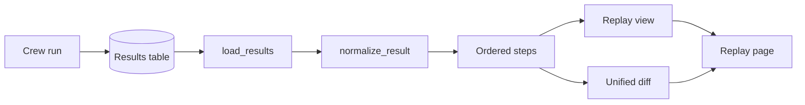

# Crew Run Replay

A Streamlit page that replays a saved agent crew run task by task and diffs two runs line by line.



## Why

A crew of agents produces a long chain of task outputs, and a small change to one prompt or one tool setting can move every step after it. The saved runs were already in the results table, but reading them meant opening two long pages side by side and scrolling. Crew Run Replay turns those stored runs into an ordered walkthrough and a readable diff, so the effect of a change can be seen in one view instead of guessed at.

## How it works

Every finished run is written to the results table with its inputs and its serialized output. The replay page reads those rows, normalizes each one into an ordered list of steps, and either walks a single run or lines two runs up against each other.

The replay logic lives in `app/run_replay.py` and is pure Python. `build_replay` takes a stored result, unwraps the `{"result": ...}` envelope that `serialize_result` adds, and calls `extract_steps`, which reads `tasks_output` (or a bare list, or a plain string) into `ReplayStep` objects sorted by their `index`, each carrying its `description`, its `output` and the run's inputs from `normalize_inputs`, which strips the `placeholder_` prefix. `final_output` keeps the crew's own answer. `run_text` flattens a run into one text block, and `diff_runs` passes two of those blocks to `difflib.unified_diff`, with the older run as the left side; `diff_summary` counts the added and removed lines and `changed_steps` lists the step titles whose output differs or that exist in only one of the two runs.

The page in `app/pg_replay.py` only draws what those helpers return. `PageReplay.load_runs` calls `db_utils.load_results` once and caches the rows in the session state, `draw_steps` shows the inputs and each step's output in order, and `draw_compare` shows the added, removed and changed counts above the unified diff. It is registered in the page list in `app/app.py` next to the existing Results page, and its labels come from the `replay` keys in `app/i18n/en.json` and `app/i18n/zh.json`.

## Key decisions

- The replay logic is kept out of the Streamlit page, so step extraction and diffing can be tested without a running app; the cost is one more module to keep in step with the result format.
- Steps are ordered by the task order stored in the run rather than by timestamp, because tasks can run asynchronously and finish out of order; a run saved without that order falls back to the order the outputs appear.
- The diff is a plain unified line diff over the rendered text, not a structured comparison of fields, which keeps it readable for any output shape but cannot tell a changed number from a changed sentence.

## Tech stack

- Python 3.12
- Streamlit 1.54
- CrewAI 1.5
- SQLAlchemy 2.0 with SQLite or PostgreSQL
- Docker and docker compose

## Quick start

Python 3.12 and the pinned requirements are needed. The database URL comes from the environment; without it the app uses a local SQLite file.

```bash
pip install -r requirements.txt
streamlit run ./app/app.py --server.headless true
```

With Docker:

```bash
docker compose up --build
```

| Variable | What it sets | Default |
| --- | --- | --- |
| `DB_URL` | SQLAlchemy connection string for the results and crew tables | local SQLite file |
| `DEFAULT_LANGUAGE` | Language of the interface on first load | `en` |
| `AGENTOPS_ENABLED` | Turns AgentOps session tracking on | off |
| `AGENTOPS_API_KEY` | Key used when AgentOps tracking is on | none |

## Usage

Open the Replay page in the sidebar, pick a saved run, and step through it. To compare, pick two runs:

```text
Run A: research-crew 2025-11-04 09:12
Run B: research-crew 2025-11-04 10:40

Step 3 of 6  gather_sources
  input: topic = "grid storage costs"
  output: 14 sources collected, 3 dropped as duplicates

Diff (A -> B)
- 14 sources collected, 3 dropped as duplicates
+ 11 sources collected, 5 dropped as duplicates
```

## Project structure

```text
app/
  app.py            page registry and sidebar
  db_utils.py       database access, load_results
  run_replay.py     step extraction and diffing
  pg_replay.py      the Replay page
  pg_results.py     the Results page
tests/
  test_run_replay.py
```

## Limitations

- Only runs that were saved to the results table can be replayed; a run stopped before it finished has no complete output to walk.
- The diff compares text line by line, so a reformatted output shows as changed even when the content is the same.
- Replay is read only; it cannot re-run a crew or edit a saved result.

## License

MIT. The licence text is in LICENSE.
